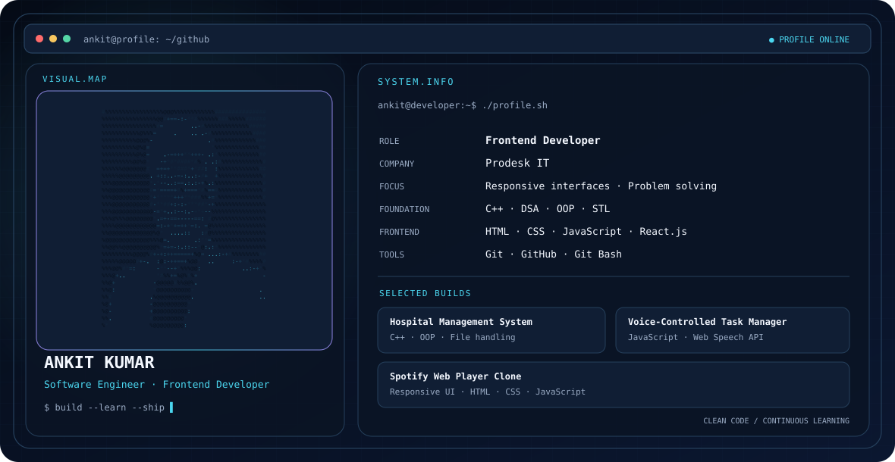

## Hi there 👋

  <picture>
    <source media="(prefers-color-scheme: dark)" srcset="./dark.svg">
    <source media="(prefers-color-scheme: light)" srcset="./light.svg">
    
  </picture>

# Hi, I'm Ankit Kumar 👋

**Software Engineer | Frontend Developer**

I build responsive, interactive web interfaces and enjoy solving programming problems. My technical foundation includes C++, Data Structures and Algorithms, OOP, and STL, alongside frontend development with HTML, CSS, JavaScript, Bootstrap, and React.js.

## About Me

- 💻 Currently working as a **Frontend Developer at Prodesk IT** (August 2026 – Present).
- 🧩 Interested in clean UI implementation, responsive design, and practical software development.
- 🧠 Strengthening my problem-solving skills through C++, DSA, and coding practice.
- 🎓 B.Tech. in Computer Science & Engineering from Suresh Gyan Vihar University, Jaipur.

## Tech Stack

**Programming:** C, C++

**Core Computer Science:** DSA, OOP, STL, Operating Systems (OS), Computer Networks (CN)

**Frontend:** HTML5, CSS3, JavaScript, Bootstrap, React.js

**Tools:** Git, GitHub, Git Bash

## Experience

### Frontend Developer — Prodesk IT
**August 2026 – Present**

- Develop and maintain responsive frontend interfaces using HTML, CSS, JavaScript, and React.js.
- Implement user-focused features with attention to responsive design, usability, and clean code.
- Use Git and GitHub for source control and development workflows.
- Contribute to assigned development tasks and application improvements.

### Salesforce Admin & Development Intern
**January 2026 – March 2026**

- Gained practical exposure to Salesforce Administration and Development.
- Worked with Salesforce platform features for configuration, customization, and application development.
- Developed an understanding of CRM processes, Salesforce workflows, and platform-based solutions.

## Featured Projects

### Hospital Management System
**C++ · OOP**

- Built a menu-driven hospital management application.
- Implemented patient registration, doctor management, appointments, and billing.
- Used file handling for persistent records and CRUD operations for patient record management.

### AI Task Manager Using Voice Control
**JavaScript · Web Speech API · HTML · CSS · Bootstrap**

- Built a task manager with voice and manual controls to add, complete, delete, and manage tasks.
- Used Local Storage to persist task data.
- Created a responsive interface with HTML, CSS, and Bootstrap.

### Spotify Web Player Clone
**HTML · CSS · JavaScript**

- Created a responsive music-player interface inspired by Spotify.
- Implemented playlist cards, sidebar navigation, player controls, a progress bar, hover effects, and transitions.
- Used Flexbox and CSS Grid to support responsive layouts.

## Achievements

- Ranked among the **Top 10% of 500+ participants** in a university-level coding competition at SGVU.
- Solved **100+ coding problems** across platforms such as GeeksforGeeks.

## Education & Certifications

**B.Tech. in Computer Science & Engineering**  
Suresh Gyan Vihar University, Jaipur · August 2022 – August 2026

**Certifications**
- C Programming — MySirG
- C++ Programming — MySirG
- Salesforce Admin & Development Internship

## Connect

- **Email:** [AnkitRaajDGA@gmail.com](mailto:AnkitRaajDGA@gmail.com)
- **LinkedIn:** Add your LinkedIn profile URL
- **GitHub:** Add your GitHub profile URL

---

*Focused on learning, building, and improving one project at a time.*
